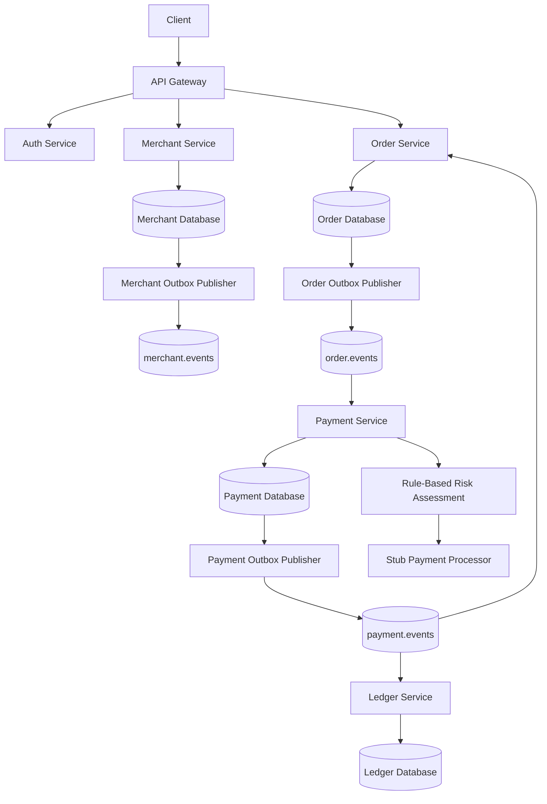
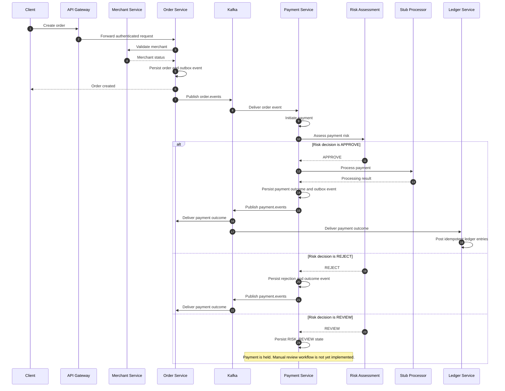

# Asterion Platform

### Reliable transactions, event by event.

Asterion is a backend engineering project that explores how to build a reliable, event-driven commerce and payment platform using Java, Spring Boot, PostgreSQL, and Apache Kafka.

The project focuses on the engineering challenges behind distributed transaction processing: service boundaries, asynchronous communication, transactional outbox patterns, retry and recovery foundations, risk decisions, and idempotent financial ledger posting.

[](https://www.oracle.com/java/technologies/javase/jdk21-archive-downloads.html)
[](https://spring.io/projects/spring-boot)
[](https://maven.apache.org/)
[](LICENSE)

---

## Why Asterion?

A payment workflow looks straightforward until failures occur between services.

Consider a customer placing an order:

- The order is committed, but the event is not published.
- A message is delivered more than once.
- A consumer crashes after processing a message but before acknowledging it.
- A payment processor responds slowly or becomes unavailable.
- A payment outcome is received more than once.
- A financial transaction must be recorded without creating duplicate ledger entries.

These are not isolated application bugs. They are distributed-systems problems that require deliberate architectural decisions.

Asterion is being developed to explore these problems through a practical, incrementally built commerce and payment platform.

The emphasis is on correctness, clear service ownership, recoverability, and testability rather than simply adding more technologies.

## Architecture

Asterion follows a service-oriented, event-driven architecture. Services own their application and domain logic, expose synchronous APIs where appropriate, and communicate asynchronously through Kafka events.



*The diagram represents the implemented service and event boundaries. The merchant event stream is published, but a downstream merchant-event consumer is not currently represented as an implemented capability.*

### Implemented payment flow



The payment processor is currently a stub implementation. This project does not initiate real financial transactions or connect to a banking/acquiring network.

## Services and responsibilities

| Service / Module | Responsibility | Current implementation |
|---|---|---|
| `api-gateway` | API entry point and request routing | JWT security integration, routing, timeout and resilience foundations |
| `auth-service` | Authentication and user lifecycle | Registration, login, refresh and logout, JWT-based authentication |
| `merchant-service` | Merchant lifecycle and ownership | Merchant creation, retrieval, updates, lifecycle transitions and event publishing |
| `order-service` | Order lifecycle | Order creation, retrieval, cancellation, completion and payment outcome handling |
| `payment-service` | Payment processing orchestration | Order event consumption, payment persistence, risk assessment, stub processing and outcome publishing |
| `ledger-service` | Financial record keeping | Idempotent double-entry posting for successful payment outcomes |
| `libraries/events` | Shared event contracts | Immutable Java record-based event contracts |
| `libraries/testing` | Shared testing support | Reusable testing infrastructure and utilities |

### Event streams

| Kafka topic | Publisher | Consumer(s) | Purpose |
|---|---|---|---|
| `merchant.events` | Merchant Service | No downstream consumer currently documented | Merchant domain events |
| `order.events` | Order Service | Payment Service | Order events that initiate payment processing |
| `payment.events` | Payment Service | Order Service, Ledger Service | Payment outcomes and downstream processing |

The event contracts are shared through the events library. They currently use immutable Java records. Schema Registry and Avro-based event evolution are future considerations.

## Key engineering decisions

### 1. Clean Architecture and dependency direction

The services are organized around domain, application, and infrastructure responsibilities.

The application layer defines use cases and ports. Infrastructure adapters implement external concerns such as persistence, messaging, and payment processing.

This keeps business logic from depending directly on framework or infrastructure implementations.

### 2. Transactional outbox pattern

Merchant, Order, and Payment use outbox foundations to persist business changes and the corresponding event records within database transactions.

Separate publishers deliver pending outbox events to Kafka.

This addresses the dual-write problem: a database transaction should not successfully commit a business change while silently losing the corresponding event.

Outbox publishing still requires duplicate-safe consumers and recovery handling. It does not provide end-to-end exactly-once delivery.

### 3. Idempotent ledger posting

The Ledger Service consumes payment outcomes and records successful payments using double-entry accounting.

The current posting model is:

| Account | Entry |
|---|---|
| `PROCESSOR_CLEARING` | Debit |
| `MERCHANT_PAYABLE` | Credit |

Duplicate payment outcomes are handled idempotently to prevent duplicate journal posting. Persistence and transaction boundaries protect the integrity of the ledger operation.

### 4. Explicit payment risk decisions

Payment processing includes a rule-based risk assessment foundation with three possible decisions:

- `APPROVE`: continue to the payment processor.
- `REJECT`: persist the rejection and publish the existing payment failure outcome.
- `REVIEW`: persist the payment in `RISK_REVIEW` and hold processing.

The current implementation is amount-threshold based. It is a foundation for risk orchestration, not a production fraud detection engine.

Manual reviewer assignment, approval/rejection APIs, reviewer authorization, and audit history are not yet implemented.

### 5. Shared event contracts

Services use shared immutable event contracts rather than independently defining incompatible message structures.

This provides a consistent starting point for event versioning and future schema governance.

### 6. Integration testing with real infrastructure

Testcontainers is used for integration testing against containerized infrastructure where appropriate.

This helps validate persistence and messaging-related behavior beyond isolated mocks.

## Technology stack

| Area | Technology |
|---|---|
| Language | Java 21 |
| Application framework | Spring Boot 3.5.x |
| Build | Maven multi-module |
| API | Spring MVC, Jakarta Validation |
| Architecture | Clean Architecture, Ports and Adapters |
| Persistence | PostgreSQL 16, Spring Data JPA, Hibernate |
| Database migrations | Flyway |
| Messaging | Apache Kafka |
| Local supporting infrastructure | Redis 7 |
| Testing | JUnit 5, Mockito, Testcontainers |
| Containers | Docker, Docker Compose |
| CI | GitHub Actions |

Kubernetes deployment, production observability, and cloud infrastructure are future work rather than currently deployed capabilities.

## Getting started

### Prerequisites

- JDK 21
- Maven
- Docker and Docker Compose
- Git
- A Kafka broker for running the asynchronous event-driven flows

### Clone the repository

```bash
git clone https://github.com/Muniraj01/asterion-platform.git
cd asterion-platform
```

### Start local infrastructure

```bash
docker compose -f infrastructure/docker-compose.yml up -d
```

The current Compose configuration starts:

| Dependency | Container image | Host port |
|---|---|---:|
| PostgreSQL | `postgres:16-alpine` | `55433` |
| Redis | `redis:7-alpine` | `6379` |

PostgreSQL configuration:

| Setting | Value |
|---|---|
| Database | `asterion_auth` |
| Username | `asterion` |
| Password | `asterion` |
| Host port | `55433` |

These are local development credentials, not production credentials.

**Kafka is not started by the current Docker Compose file.** Start and configure a Kafka broker separately before running the asynchronous service flows.

The services use `KAFKA_BOOTSTRAP_SERVERS` for the Kafka bootstrap address; the default is `localhost:9092`.

### Build the project

```bash
mvn clean install
```

### Run the test suite

```bash
mvn clean verify
```

### Stop local infrastructure

```bash
docker compose -f infrastructure/docker-compose.yml down
```

To remove the local PostgreSQL data volume as well:

```bash
docker compose -f infrastructure/docker-compose.yml down -v
```

**Warning:** The `-v` option deletes the local Compose-managed database volume and its data.

Service-specific configuration and environment variables should be checked in each service's `application.yml` before starting individual applications.

## API overview

The following endpoints are implemented in the service controllers. They are protected or authenticated according to their service-level security integration; use the API Gateway and configured authentication flow when exercising protected operations.

### Authentication

Base path: `/api/v1/auth`

| Method | Endpoint | Purpose |
|---|---|---|
| POST | `/api/v1/auth/login` | Authenticate a user and issue tokens |
| POST | `/api/v1/auth/refresh` | Refresh access and refresh tokens |
| POST | `/api/v1/auth/logout` | Invalidate a refresh token |

### User registration

| Method | Endpoint | Purpose |
|---|---|---|
| POST | `/api/v1/users/register` | Register a user |

Example request:

```json
{
  "email": "customer@example.com",
  "password": "ReplaceWithAStrongPassword"
}
```

### Merchant management

Base path: `/api/v1/merchants`

| Method | Endpoint | Purpose |
|---|---|---|
| POST | `/api/v1/merchants` | Create a merchant |
| GET | `/api/v1/merchants` | List the authenticated user's merchants |
| GET | `/api/v1/merchants/{merchantId}` | Retrieve a merchant |
| PUT | `/api/v1/merchants/{merchantId}` | Update merchant details |
| POST | `/api/v1/merchants/{merchantId}/activate` | Activate a merchant |
| POST | `/api/v1/merchants/{merchantId}/suspend` | Suspend a merchant |
| POST | `/api/v1/merchants/{merchantId}/reactivate` | Reactivate a merchant |
| POST | `/api/v1/merchants/{merchantId}/terminate` | Terminate a merchant |

Example create request:

```json
{
  "businessName": "Example Store",
  "legalName": "Example Store Private Limited",
  "contactEmail": "payments@example.com"
}
```

### Order management

Base path: `/api/v1/orders`

| Method | Endpoint | Purpose |
|---|---|---|
| POST | `/api/v1/orders` | Create an order |
| GET | `/api/v1/orders` | List the authenticated user's orders |
| GET | `/api/v1/orders/{orderId}` | Retrieve an order |
| POST | `/api/v1/orders/{orderId}/cancel` | Cancel an order |
| POST | `/api/v1/orders/{orderId}/complete` | Complete an order |

Example create request:

```json
{
  "merchantId": "00000000-0000-0000-0000-000000000001",
  "totalAmount": 1250.00
}
```

The order creation flow validates the merchant and requires it to be active. Order access is scoped to the authenticated user.

### Payment and ledger

Payment processing and ledger posting are currently driven by Kafka events rather than a documented public payment REST API.

- Payment Service consumes order events and initiates payment processing.
- Payment outcomes are published through the payment event stream.
- Order Service consumes payment outcomes to update order state.
- Ledger Service consumes payment outcomes and posts successful payments.

The current processor is a stub. Do not use this project to process real payments.

## Testing strategy

The project uses multiple testing levels to validate behavior and service boundaries.

| Test level | Purpose |
|---|---|
| Unit tests | Validate domain rules and application use cases in isolation |
| Adapter tests | Validate infrastructure and integration adapter behavior |
| Persistence integration tests | Validate database mappings, persistence behavior and transaction boundaries |
| Messaging integration tests | Exercise event-driven integration behavior where covered by the test suite |
| Full reactor verification | Validate the multi-module build and test suite together |

The project uses JUnit 5, Mockito, and Testcontainers.

### Recorded verification baseline

The documentation branch's last recorded full Maven verification completed with:

| Module | Tests |
|---|---:|
| API Gateway | 31 |
| Auth Service | 49 |
| Merchant Service | 170 |
| Order Service | 96 |
| Payment Service | 47 |
| Ledger Service | 16 |
| **Total** | **409** |

**Result:** 409 tests, 0 failures, 0 errors, 0 skipped.

Re-run the full verification command on the current branch to confirm its latest result:

```bash
mvn clean verify
```

Test counts can change as new features and tests are added.

## Continuous integration

GitHub Actions runs the Maven verification pipeline:

- On pushes to `main`.
- On pull requests targeting `main`.
- With Java 21 (Temurin).
- With PostgreSQL and Redis services provisioned for CI.
- By executing `mvn clean verify`.

The CI workflow is maintained at:

`.github/workflows/ci.yml`

## Repository structure

```text
asterion-platform/
├── .github/
│   └── workflows/
│       └── ci.yml
│
├── docs/
│   ├── adr/
│   │   ├── ADR-001-project-structure.md
│   │   ├── ADR-002-monorepo.md
│   │   ├── ADR-003-clean-architecture.md
│   │   ├── ADR-004-root-maven-build.md
│   │   ├── ADR-005-shared-event-contracts.md
│   │   ├── ADR-006-testcontainers-based-integration-testing.md
│   │   └── ADR-007-clean-architecture-service-structure.md
│   ├── api/
│   ├── architecture/
│   ├── engineering/
│   └── runbooks/
│
├── infrastructure/
│   └── docker-compose.yml
│
├── infra/
│   ├── docker/
│   ├── kubernetes/
│   ├── monitoring/
│   └── scripts/
│
├── libraries/
│   ├── events/
│   └── testing/
│
├── services/
│   ├── api-gateway/
│   ├── auth-service/
│   ├── merchant-service/
│   ├── order-service/
│   ├── payment-service/
│   └── ledger-service/
│
├── pom.xml
├── LICENSE
└── README.md
```

## Production considerations

Asterion is an engineering project and is not currently a production-ready payment platform.

Moving it towards production would require additional work across several areas.

| Area | Further engineering required |
|---|---|
| Payment processing | Integrate a real payment provider or acquiring network; implement provider-specific timeout, retry and reconciliation behavior |
| Risk management | Add manual review workflows, reviewer authorization, audit trails and richer risk signals |
| Ledger | Add fees, refunds, reversals, settlement, reconciliation and operational controls |
| Messaging | Introduce schema governance, event compatibility policies, dead-letter operations and stronger replay tooling |
| Data infrastructure | Production-grade database topology, backup, restore and disaster recovery |
| Security | Centralized secrets management, key rotation, rate limiting, threat modeling and security reviews |
| Compliance | Assess PCI DSS scope and applicable financial, privacy and regulatory requirements |
| Observability | Distributed tracing, structured logs, metrics, dashboards, alerting and service-level objectives |
| Deployment | Kubernetes or equivalent orchestration, deployment automation, canary releases and rollback procedures |
| Reliability | Load testing, fault injection, capacity planning, operational runbooks and incident response |

These are planned engineering considerations, not claims about existing functionality.

## Roadmap

The platform is being developed incrementally, with an emphasis on completing reliable service boundaries before expanding the feature set.

- [x] Multi-module Java 21 and Spring Boot foundation
- [x] API Gateway and authentication foundation
- [x] Merchant lifecycle management
- [x] Order lifecycle and event publishing
- [x] Payment processing foundation with a stub processor
- [x] Transactional outbox foundations
- [x] Payment risk assessment foundation
- [x] Ledger foundation with idempotent double-entry posting
- [ ] Manual payment risk review workflow
- [ ] Reviewer authorization and audit history
- [ ] Refund and reversal workflows
- [ ] Settlement and reconciliation
- [ ] Event schema governance and compatibility strategy
- [ ] Production observability and operational runbooks
- [ ] Container orchestration and deployment automation
- [ ] Load, resilience and failure-recovery testing

## Engineering principles

The project prioritizes:

- **Correctness over convenience:** financial state transitions and ledger entries must be deliberate and testable.
- **Explicit ownership:** each service owns its business responsibilities and persistence behavior.
- **Resilience:** asynchronous processing must account for retries, duplicate delivery and recovery.
- **Idempotency:** repeated event delivery must not create duplicate financial postings.
- **Separation of concerns:** business rules should remain independent of infrastructure details.
- **Incremental delivery:** each milestone should leave the platform buildable and verifiable.

## Demo and walkthrough

There is currently no hosted public demo.

The recommended way to explore the project is to run the services and infrastructure locally, inspect the API flows, and follow the event-driven payment and ledger path through the implementation and tests.

A recorded end-to-end walkthrough and architecture screenshots can be added here as the project matures.

## License

This project is licensed under the **Apache License 2.0**. See the [LICENSE](LICENSE) file for the complete license text.

## Author

**Muniraj K A**

Backend engineering project focused on Java, distributed systems, event-driven architecture, payment processing, and reliable financial workflows.

---

*Built as a practical exploration of the engineering decisions behind reliable distributed transaction systems.*