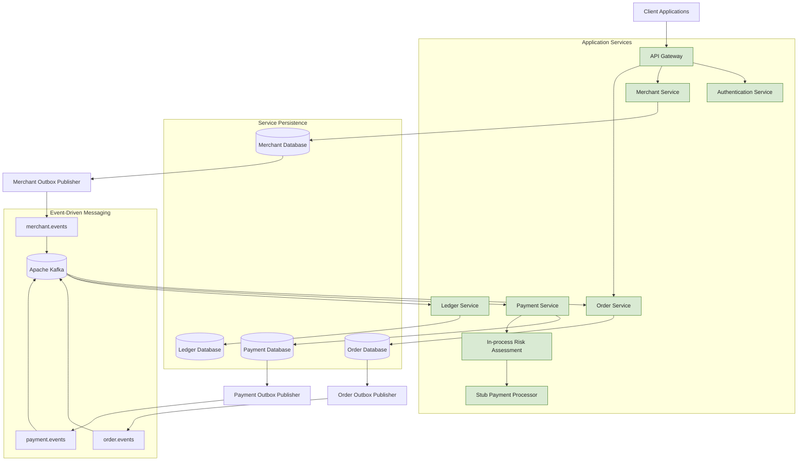

# Asterion Platform

An event-driven transaction platform built with Java 21 and Spring Boot, demonstrating reliable service-to-service communication, payment processing foundations, and double-entry ledger posting.

Asterion is a portfolio engineering project focused on the architectural and operational challenges of building distributed commerce and payment systems: service boundaries, asynchronous workflows, transactional outbox patterns, idempotency, failure recovery, and data consistency.

> **Project status:** Core service foundations and event-driven payment-to-ledger flow are implemented. External payment processing, production fraud operations, and deployment infrastructure remain future work.

## Architecture

The platform is organized around independently bounded application services, shared event contracts, and asynchronous communication through Kafka.



The diagram represents logical service and messaging boundaries. It does not imply that every service currently runs as a separately deployed production instance or has a separately provisioned database server.

### Implemented event flows

```mermaid
sequenceDiagram
    participant Client
    participant Gateway
    participant Order
    participant OrderDB
    participant Kafka
    participant Payment
    participant PaymentDB
    participant Processor
    participant Ledger
    participant LedgerDB

    Client->>Gateway: Create order
    Gateway->>Order: Forward request
    Order->>OrderDB: Persist order and outbox event
    OrderDB-->>Order: Transaction committed
    Order->>Kafka: Outbox publisher sends OrderCreated
    Kafka->>Payment: Consume order.events
    Payment->>PaymentDB: Persist